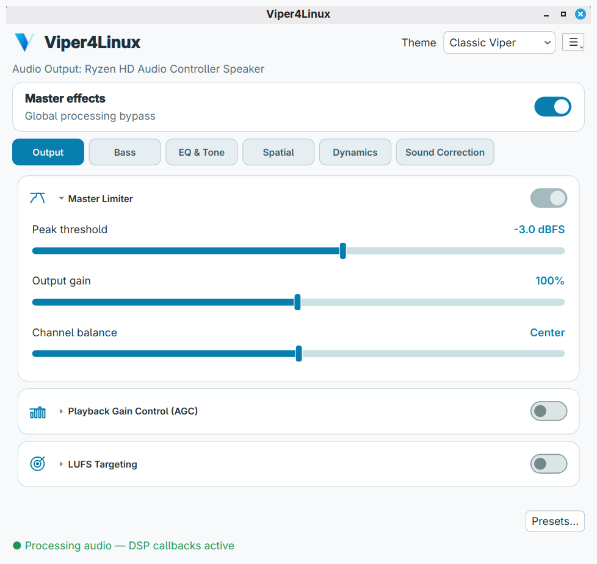
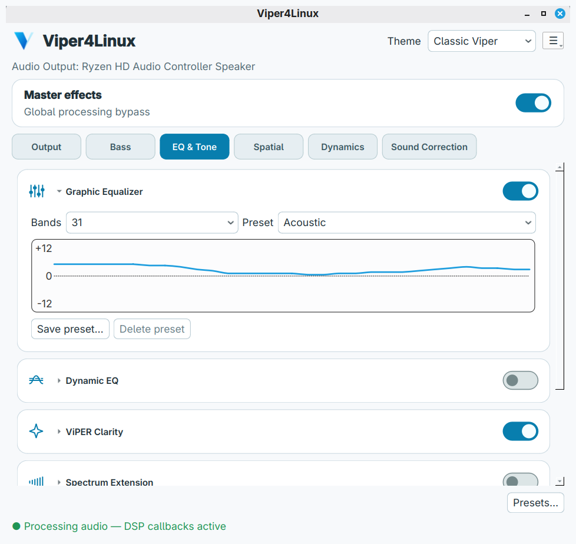
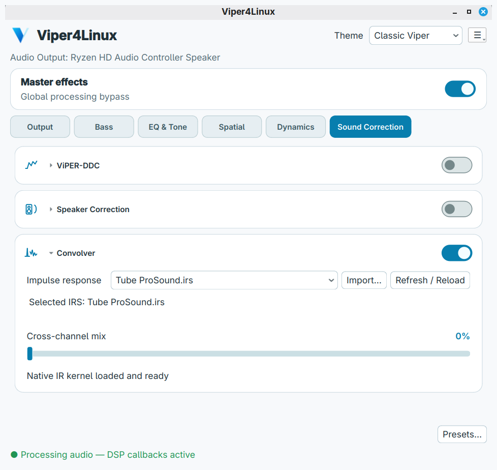
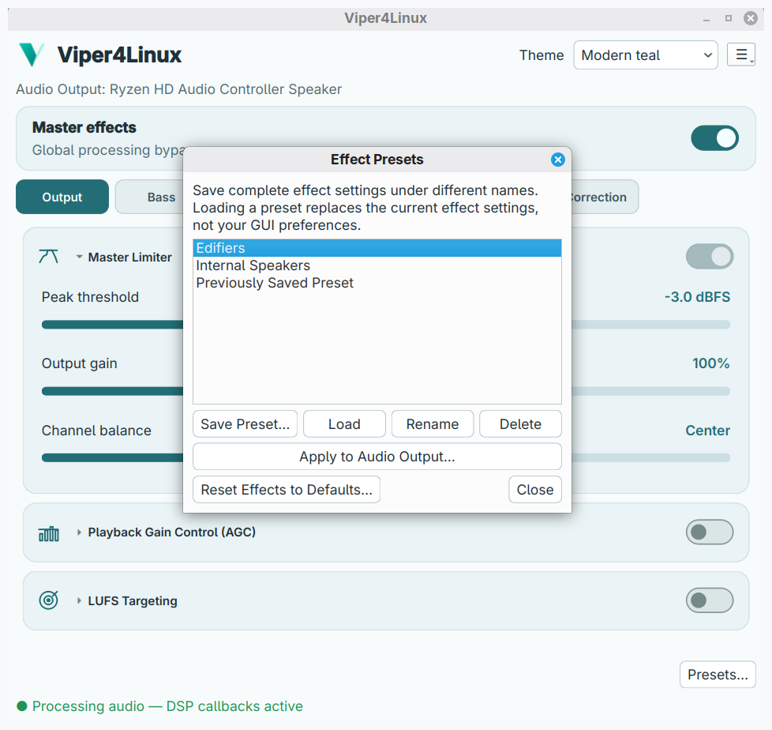
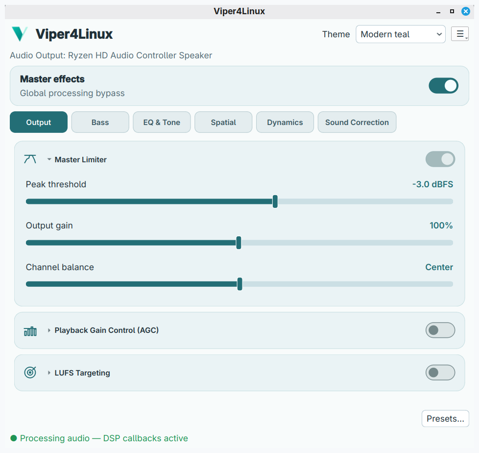

# ViPER4Linux-RE

**Bringing ViPER back to Linux.**

I've always wanted a modern, working version of ViPER for Linux. The older
ViPER4Linux project hadn't been updated in years and no longer worked smoothly
for me, so I decided to see whether something new could be built.

ViPER4Linux-RE is the result. It brings ViPER's extensive sound enhancements
to the Linux desktop, letting you customize bass, clarity, surround sound,
equalization, and much more. It works with your existing music players and other
audio applications, without requiring you to change how you listen.

While building the GUI, I attempted to keep the *essence* of the original
ViPER4Android alive, so that it still feels like ViPER:

<!-- BEGIN ViPER4Linux screenshot gallery -->

<p align="center">
  
</p>

## Additional Screenshots

<details>
<summary><strong>EQ &amp; Tone</strong> — 31-band graphic equalizer with Acoustic preset</summary>



</details>

<details>
<summary><strong>Sound Correction</strong> — native IRS convolution</summary>



</details>

<details>
<summary><strong>Effect Presets</strong> — save, load, rename and assign to audio outputs</summary>



</details>

<details>
<summary><strong>Modern teal theme</strong> — alternative visual style</summary>



</details>

<!-- END ViPER4Linux screenshot gallery -->


## A little about this project

I'm not a software developer. I created this project with the assistance of AI,
initially for my own use. But as it began to work, I realized it might be worth
sharing.

My primary goal is to demonstrate that this can be done. I'd be thrilled if an
experienced developer—or a group of developers—found the project interesting
enough to fork it, improve the code, and take it further than I can.

Until then, I'll do my best to maintain and improve it myself.

This is a working proof of concept, not a finished commercial product. I'm
sharing it because I believe there's still a place for ViPER on Linux, and I'd
like to see what the community can make of it.

> **Development status:** This project is under active development. Arch Linux with Cinnamon/X11 is the
> primary tested environment; KDE Plasma tray integration and other Linux
> environments need further testing. See [Current limitations](#current-limitations).

**For contributors:** `main` uses CMake for pinned ViPERDSP preparation, native builds, developer verification, and guarded system-package staging. See the [developer guide](docs/DEVELOPMENT.md) and [Arch packaging guide](docs/ARCH-PACKAGING.md). This was a build and packaging modernization, not a user-facing DSP or GUI feature change.

## What it offers

- **24 native ViPERDSP effect groups**, organized into six tabs rather than one
  long settings page.
- **PipeWire filter-chain integration** using a native LADSPA module; no
  Android runtime, Wine, or bundled web framework.
- **Smart output routing** to the default physical output, with recovery across
  ordinary player changes and supported Bluetooth reconnections.
- **Independent GUI and audio backend:** closing the interface leaves audio
  processing running. GUI-only upgrades do not need to interrupt playback.
- **Qt6 desktop interface:** collapsible effect cards, light/dark themes,
  system tray, optional login autostart, and configurable minimize/close behavior.
- **Named presets and external libraries** for impulse responses (`IRS`) and
  headphone correction profiles (`VDC`), plus a CLI for selected live controls.
- **Per-output effect memory** for independently remembered physical speakers
  and headphones, with saved-preset assignment to connected or disconnected
  outputs and restoration before music starts.

### Effect categories

| Tab | Included effects |
| --- | --- |
| **Output** | Master Limiter, Playback Gain Control, LUFS Targeting |
| **Bass** | ViPER Bass, ViPER Bass Mono, Psychoacoustic Bass, Dynamic System |
| **EQ & Tone** | Graphic EQ, Dynamic EQ, ViPER Clarity, Spectrum Extension, Tube Simulator, AnalogX |
| **Spatial** | Headphone Surround+, Differential Surround, Field Surround, Reverberation, Cure/Crossfeed, Stereo Imager |
| **Dynamics** | FET Compressor, Multiband Compressor |
| **Sound Correction** | Convolver, ViPER-DDC, Speaker Correction |

Each effect has its own enable control. The complete control and limitation
reference is in [docs/EFFECTS.md](docs/EFFECTS.md); not every internal upstream
parameter is exposed in the GUI yet.

## How it works

```text
Music players / other audio applications
                 |
              PipeWire
                 |
     ViPER for Linux filter-chain sink
        (LADSPA + native ViPERDSP)
                 |
        Selected physical output
       (headphones, speakers, etc.)

 Qt6 GUI / viper4linux-ctl
                 |
       Shared control interface
                 |
          Audio processing
```

The launcher starts the DSP backend when necessary, reuses a compatible
running instance, and replaces an outdated one when its backend components
have changed. It does **not** restart PipeWire itself. The DSP runs separately
from the GUI, so the window can be minimized, hidden in the tray, or closed
without stopping processing.

See the [user guide](docs/USER-GUIDE.md) for routing, tray settings, and
troubleshooting, and the [developer guide](docs/DEVELOPMENT.md) for the
architecture and source layout.

## Building and running

**Current platform:** Arch Linux, with PipeWire and Qt6 Widgets. These
instructions build directly from source; see the [Arch packaging guide](docs/ARCH-PACKAGING.md)
for system package installation.

Install the build dependencies on Arch:

```bash
sudo pacman -S --needed base-devel cmake git pkgconf ladspa pipewire qt6-base python
```

Clone the application and its pinned ViPERDSP submodule, then build:

```bash
git clone --recurse-submodules https://github.com/username227/viper4linux-re.git
cd viper4linux-re
cmake -S . -B build -DCMAKE_BUILD_TYPE=Release
cmake --build build --parallel 4
cmake --build build --target viper_source_check
```

These commands apply to the current **`main` branch**. In an existing
checkout, initialize the recorded submodule with
`git submodule update --init --checkout third_party/ViPERDSP` before CMake.
CMake verifies that revision and applies the three real-time compatibility
patches to a **private build copy** without editing upstream sources.
It generates source routing files under `build/routing-config/` and supports
incremental rebuilds. `viper_source_check` verifies binaries, LADSPA export,
and routing files without starting audio. Run `./viper4linux` only when
you intend to launch the source version (which may replace an existing backend).

The optional developer-only `viper_source_links` CMake target can create
private shortcuts but never runs during a normal build. See the
[developer guide](docs/DEVELOPMENT.md). For builds managed by pacman, see
[Arch packaging](docs/ARCH-PACKAGING.md). 

Once installed as a system package, run `viper4linux` from the application
menu or a terminal. For example:

```bash
viper4linux-ctl status
viper4linux-ctl --help
```

The effects CLI does not expose every GUI setting or manage complete named
presets; the separate `viper4linux-output` utility supports per-output preset
assignment. The
installed man pages (`man viper4linux` and `man viper4linux-ctl`) document
the supported commands.

## Presets, profiles, and settings

Active settings are saved automatically. Named presets are separate snapshots
that you can save, load, rename or delete; resetting to the application's
defaults does **not** delete them. External `.irs`/supported `.wav` responses
and `.vdc` correction profiles are selected from their own libraries.

Typical user data layout:

```text
~/.local/share/viper4linux/
├── presets/       named effect configurations
├── outputs/       physical Audio Output snapshots and inventory
├── IRS/           impulse responses for Convolver
└── VDC/           ViPER-DDC correction profiles
```

See [presets and external libraries](docs/PRESETS-AND-LIBRARIES.md) for import
behavior, backup considerations, and what a preset does *not* embed.

## Current limitations

- **Testing coverage:** native audio, hardware combinations, and sample-rate
  behavior still need broader independent testing. Cinnamon/X11 tray behavior
  has been tested; KDE Plasma has not.
- **Some advanced DSP controls** are not individually exposed in the GUI; the
  CLI is a subset of GUI functionality, not a complete scripting API.
- **ViPER-DDC** requires a valid `.vdc` file and its native processor currently
  handles only 44.1 and 48 kHz.
- **JamesDSP** may compete for PipeWire routing; reliable simultaneous
  processing has not been established.
- **PulseAudio** is not supported. The backend requires PipeWire.

## Acknowledgments

This project wouldn't exist without the efforts of others who helped bring
ViPER to Linux and made its audio processing engine accessible.

I'd particularly like to thank:

- **[Noah Bliss](https://github.com/noahbliss/Viper4Linux)** — for the original
  Viper4Linux project and his pioneering efforts to bring ViPER to the Linux
  desktop.
- **[ThePBone](https://github.com/Audio4Linux/Viper4Linux-GUI)** — for the earlier
  Viper4Linux graphical interface and contributions to Linux audio processing.
- **[likelikeslike](https://github.com/likelikeslike/ViPERDSP)** — for developing
  and maintaining the standalone reverse-engineered ViPERDSP library that makes
  this implementation possible.

Their work provided both the inspiration and the foundation for this experiment,
and I'm grateful for their contributions.

## Source, contributions, and licensing

The original application, Qt interface, PipeWire integration, launcher, CLI
and original supporting code are Copyright (C) 2026 Gerald Frank
(`username227`) and are licensed under the
[GNU General Public License version 3 only](LICENSE) (`GPL-3.0-only`).
The project copyright statement is in [COPYRIGHT](COPYRIGHT).
Earlier MIT-licensed versions retain the permissions originally granted;
the new GPL license does not retroactively revoke them.
**The GPL license applies only to original code licensed by its copyright
holder; it does not relicense ViPERDSP or other third-party material.**

ViPERDSP is a [separate upstream project](https://github.com/likelikeslike/ViPERDSP),
tracked here as a pinned Git submodule in `third_party/ViPERDSP`. Its upstream
README describes restrictions on use and does not grant a conventional
open-source redistribution license. **Do not assume that our GPL license
permits redistribution of the combined DSP library, binary packages or
unified-source archives.** See [third-party notices](THIRD-PARTY-NOTICES.md)
and the [development guide](docs/DEVELOPMENT.md) for the exact dependency
revision and three separately applied downstream fixes.

The project's source and documentation are intended to be reviewable and
forkable. Improvements to our original Linux integration are welcome; please
keep changes to upstream DSP code clearly distinguished from integration
changes. Releases and subsequent improvements will be documented in this repository.

## Documentation

| Guide | Covers |
| --- | --- |
| [User guide](docs/USER-GUIDE.md) | Running the app, routing, tray, settings, troubleshooting |
| [Effects reference](docs/EFFECTS.md) | All 24 effect groups, parameters and cautions |
| [Presets and libraries](docs/PRESETS-AND-LIBRARIES.md) | Named presets, IRS, VDC, file locations |
| [Arch packaging](docs/ARCH-PACKAGING.md) | `-git` builds and stable source-distribution plan |
| [Debian/Ubuntu/Mint packaging](docs/DEB-PACKAGING.md) | Native `.deb` builds, supported release bases and manual publication |
| [Developer guide](docs/DEVELOPMENT.md) | Architecture, patch inventory, tests, outstanding work |

**Project:** [username227/viper4linux-re](https://github.com/username227/viper4linux-re)

**DSP dependency:** [likelikeslike/ViPERDSP](https://github.com/likelikeslike/ViPERDSP)
